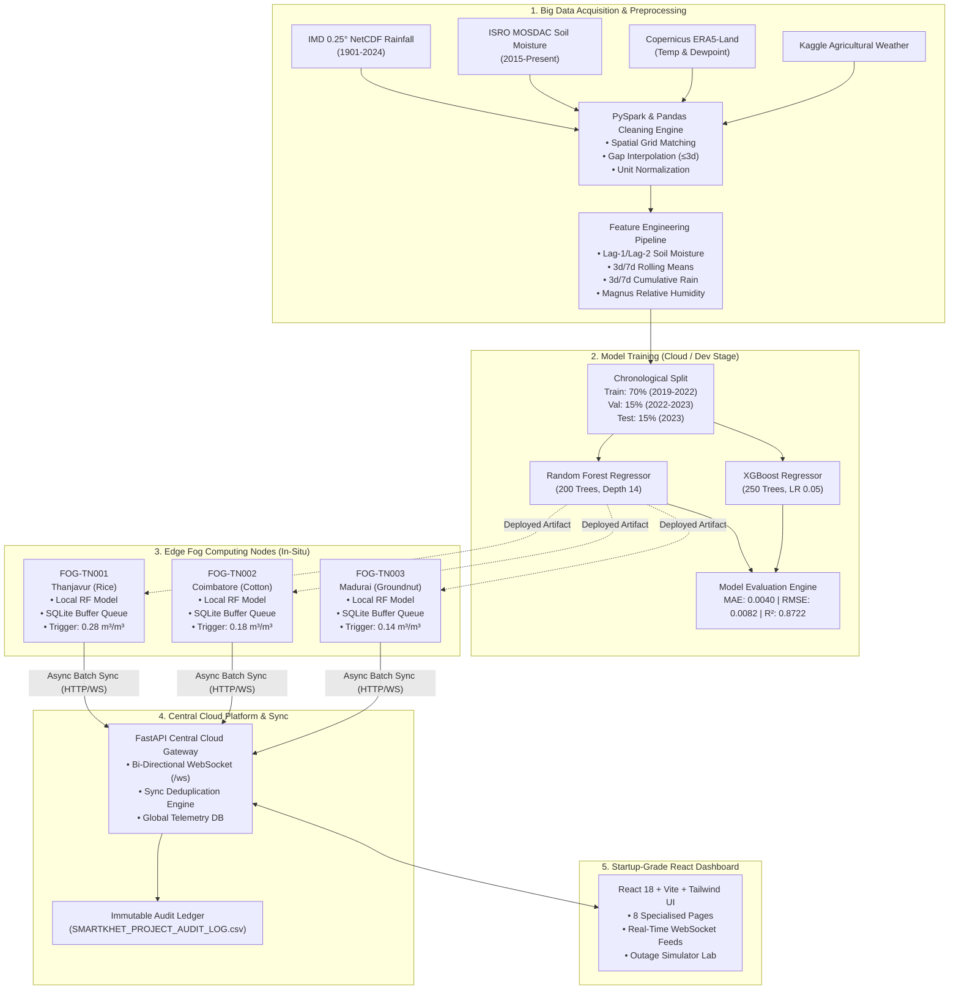

# SmartKhet 2.0: System Architecture & Design Specification
### Big Data-Powered Fog-Based Intelligent Rural Irrigation Platform

## 1. System Overview

SmartKhet 2.0 is an academic and startup prototype demonstrating how authentic historical agricultural meteorology, machine learning soil moisture estimation, and localized Fog Computing collaborate to support intelligent irrigation decisions in rural Tamil Nadu, India.

---

## 2. Key Architectural Tenets

### 2.1 Decoupled Edge Inference (Fog Computing)
In traditional IoT architectures, edge nodes stream raw sensor telemetry directly to the cloud for inference. In rural regions across India, backhaul connectivity experiences frequent brownouts, high jitter, and high packet drop rates. SmartKhet 2.0 inverts this paradigm:
1. **Local Autonomy:** Each Fog node holds a localized, compiled Random Forest model (`rf_model.joblib`).
2. **Deterministic Latency:** Local inference executes in **11–14 ms**, independent of internet connection speed.
3. **Fail-Safe Offline Mode:** When the cloud uplink fails, the Fog node maintains 100% decision availability. Events are staged into an append-only SQLite ring buffer.
4. **Resilient Synchronization:** Once backhaul connectivity is restored, buffered events are flushed to the cloud in an idempotent, deduplicated batch.

### 2.2 Strict Separation of Ground Truth vs. ML Predictions
The user interface and data services maintain an uncompromised distinction:
- **Historical Ground Truth:** Observations derived from IMD, ISRO, and ERA5-Land records.
- **Model Predictions:** Clearly flagged with `is_predicted: true`, displaying confidence intervals and explicit scientific disclaimers.

---

## 3. Technology Stack Justification

| Layer | Technology | Rationale |
|---|---|---|
| **Frontend** | React 18, TypeScript, Tailwind CSS, Recharts, Lucide | Startup-grade responsiveness, type safety, modular dashboard views. |
| **Backend** | Python 3, FastAPI, Pydantic v2, SQLAlchemy | Async concurrency, high-performance serialization, SQLite WAL mode. |
| **Big Data Engine** | PySpark, Pandas, NumPy | NetCDF processing, robust geospatial extraction, scalable ETL. |
| **Machine Learning** | Scikit-Learn (RandomForest), XGBoost | High interpretability, resistance to overfitting, low edge inference latency. |
| **Edge Storage** | SQLite (WAL Mode) | Zero-configuration, zero-dependency embedded database for local edge buffering. |
| **Communication** | REST API + WebSockets (`/ws`) | Standardized query layer with low-latency live telemetry broadcasting. |

